I tested Flux EDA over the course of two weeks. As a hardware designer who already knows how to use EasyEDA and KiCad, I thought this would be an easy task; but using Flux turned out to be more challenging than my initial expectations.

> As of mid 2025,
> It still has a long way to go before being fully production-ready. For now, I'll hold off and wait until its ready

---

# The Good

Here are several features that I found impressive, which set Flux EDA apart from other tools:

## 1) Realtime BOM prices

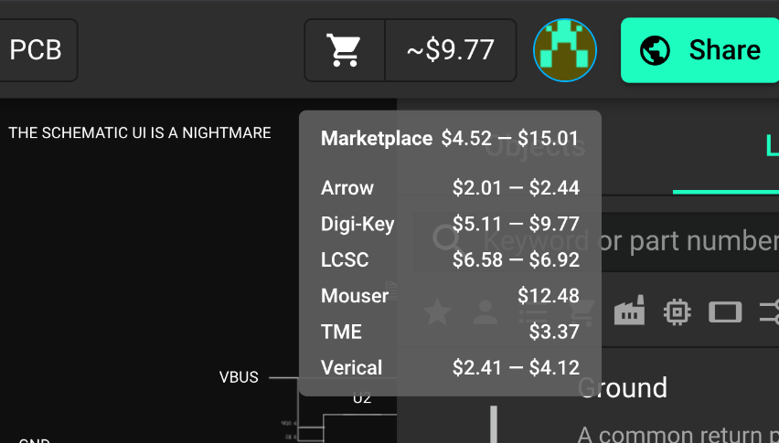

On the top right corner of the UI, there is a Price display. It updates in realtime as you add or remove components. This is very handy especially when you're designing a board for batch production.

This feature is not yet available in EasyEDA and KiCad. While Altium does have an advanced feature called ActiveBOM, The way it is implemented in Flux is straightforward and user-friendly.

## 2) Schematic - PCB Layout Live sync

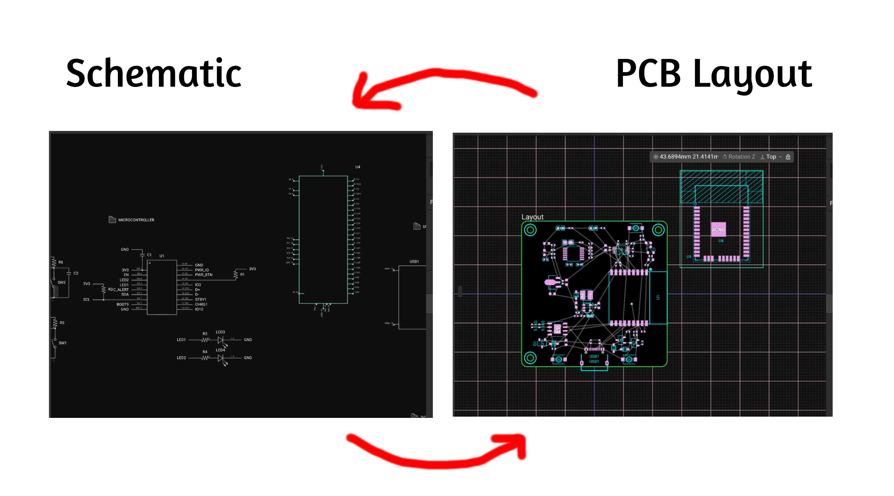

Any change made in the Schematic is instantly reflected in the PCB Layout workspace, and vice versa. For context the other EDA tools require the user to manually import the changes from one workspace to another.

This might be ideal or not, depending on your workflow, but it was very helpful for me.

## 3) Project Gallery

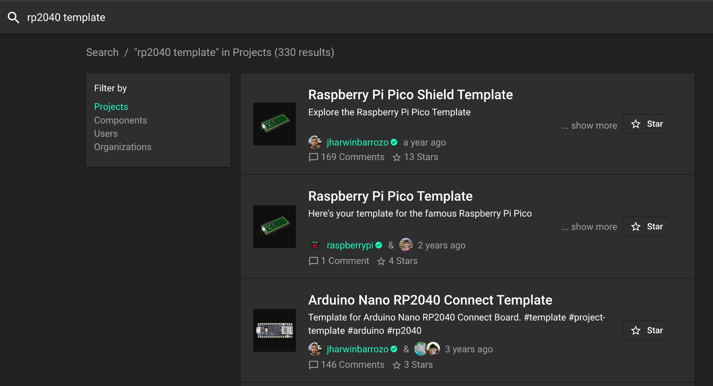

While this is not an exclusive feature, the implementation in Flux is user friendly. These are projects contributed by a user. Flux has a great way to search and find these projects, Both templates and projects are searchable (they are essentially the same in flux)

In case of the other EDA tools, you will have to find it somewhere on the internet. Like github in case of Kicad. While Easyeda does have an open Gallery called OSHWLab with all the open source projects, the user contributed Modules are not yet searchable.

> Templates and Modules are circuits which are reused in multiple projects, a good analogy is the boilerplate code in programming.

## 4) Co-pilot for Component Search

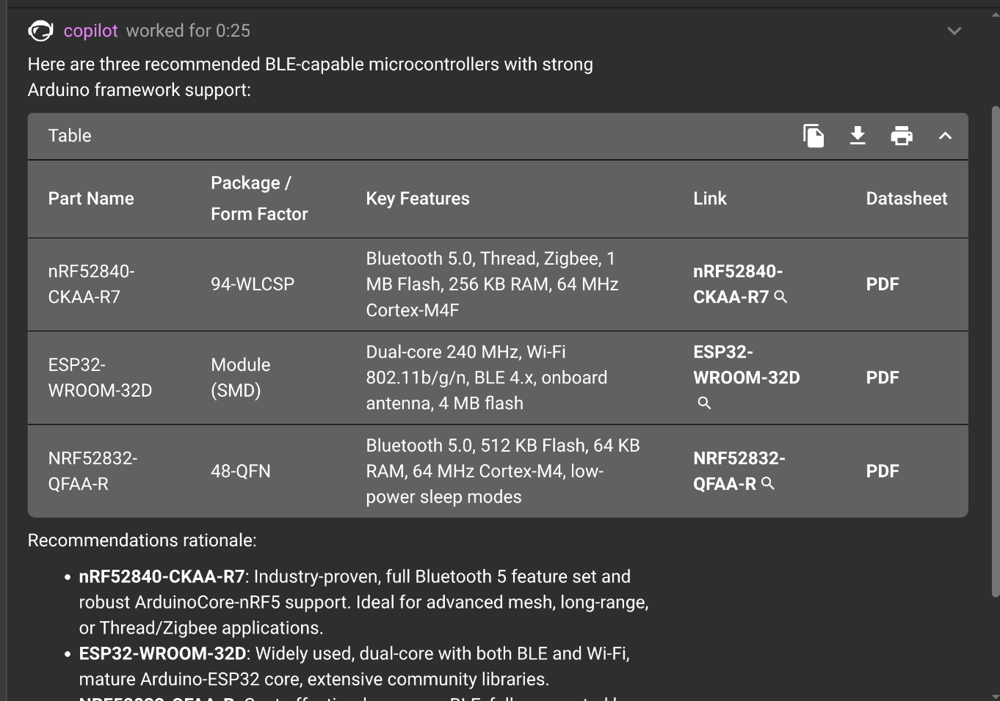

The co-pilot chat box is helpful when searching for components. Usually we have to visit a suppliers website and use the filters to find the perfect component.

This co-pilot has a context of the components and its features for most manufacturers. For beginners this should be more than enough to get started.

That's all the AI is good for. The co-pilot is a double-edged sword for Flux, and we'll explore that in the last part.

## 5) Customer support

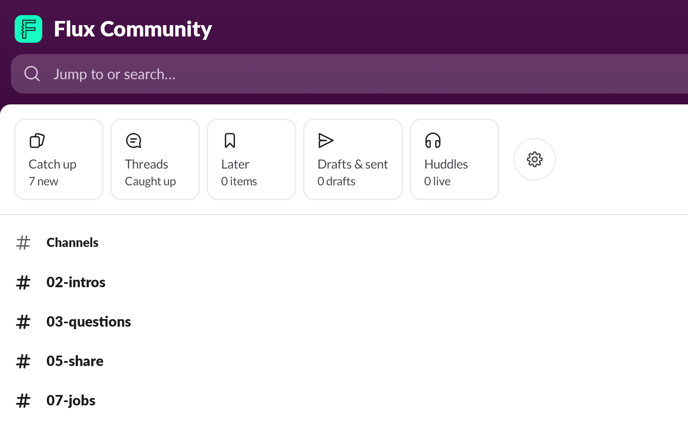

I have been observing the flux slack group for the past two weeks, The Flux team is highly responsive, addressing user queries and clarifying doubts. They also add components to the Flux library based on user requests, that is good.

---

# The BAD

Some of the pain points associated with using Flux EDA.

## 1) Schematic UI

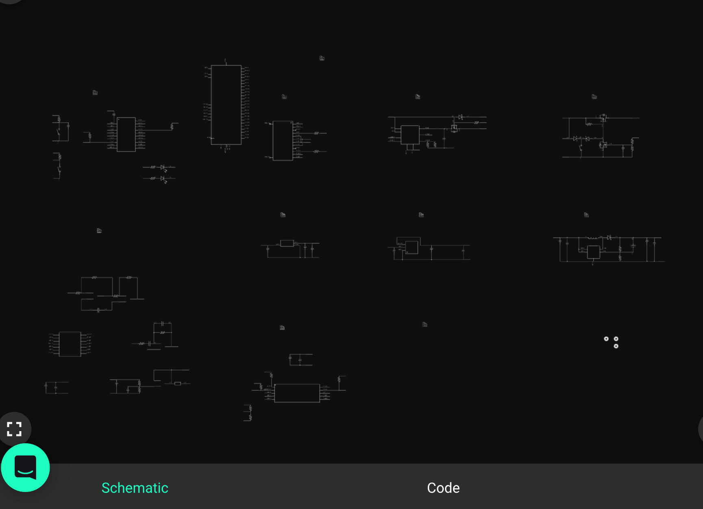

I like that a dark mode is available, but why like this. Can you see whats in the schematic? The issue is not the dark mode, but the line width and monocolor UI.

Here's a schematic from EasyEDA for reference,

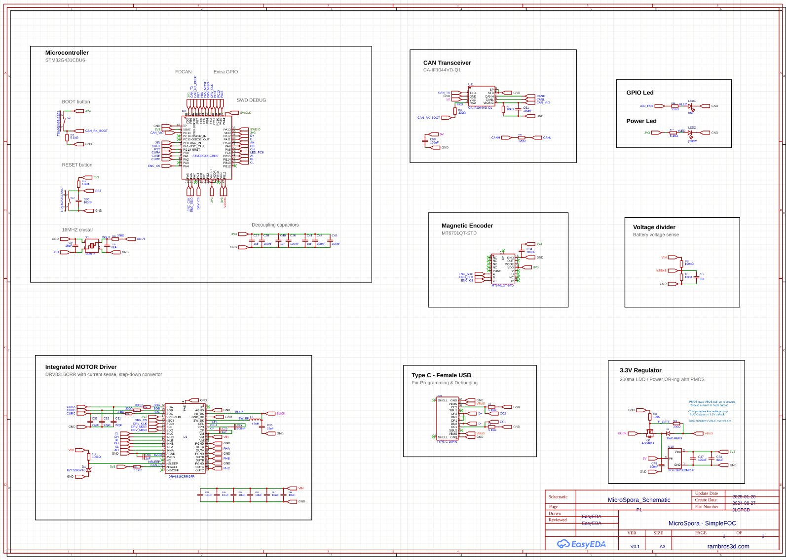

For more complex designs, flux is not suitable since we also cant organize the schematic into different sheets. Official suggestion is to use the modules feature as a workaround.

My designs are usually simple, so I rarely have to use multiple schematic sheets. But I still had a hard time with that Flux schematic UI.

## 2) Everything combined into "Library"

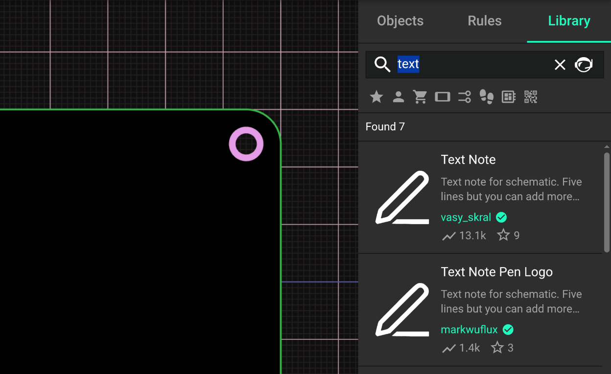

All the EDA tools treat the components and common tools (like pads, holes, lines, text) separately. Flux combines everything into the library. Anyone who has worked with a different EDA (like KiCAD, EasyEDA) will find this annoying.

Here's a screenshot from KiCAD, It is better to keeps these tools and components separate.

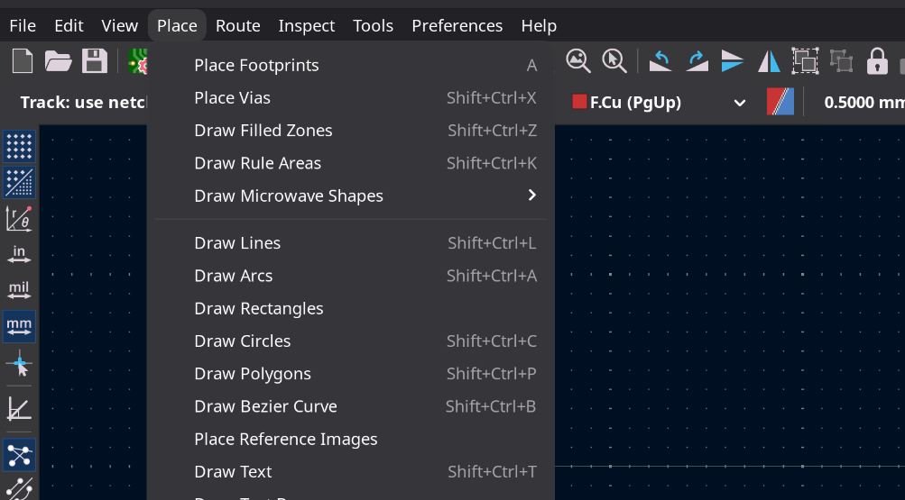

Maybe flux is trying for a different experience.

## 3) Rules Editor

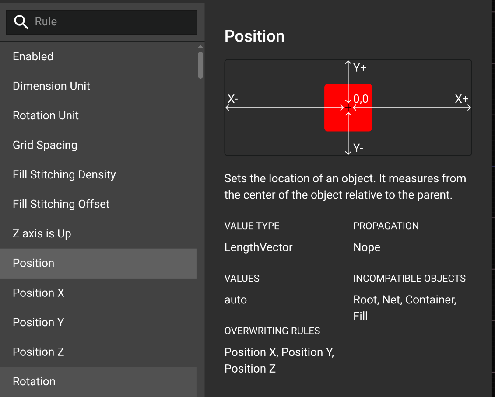

The rules editor looks more oriented to programmers, the language definitely sounds that way (Objects, Values, Types). The rules is setup like CSS, not sure why they chose this for a PCB design software.

This might be easy for programmers who are looking to get into hardware design. But for hardware designers who are looking to switch from a different EDA tool; its gonna be a real pain.

For reference, the Altium rules manager still manages to keep it simple.

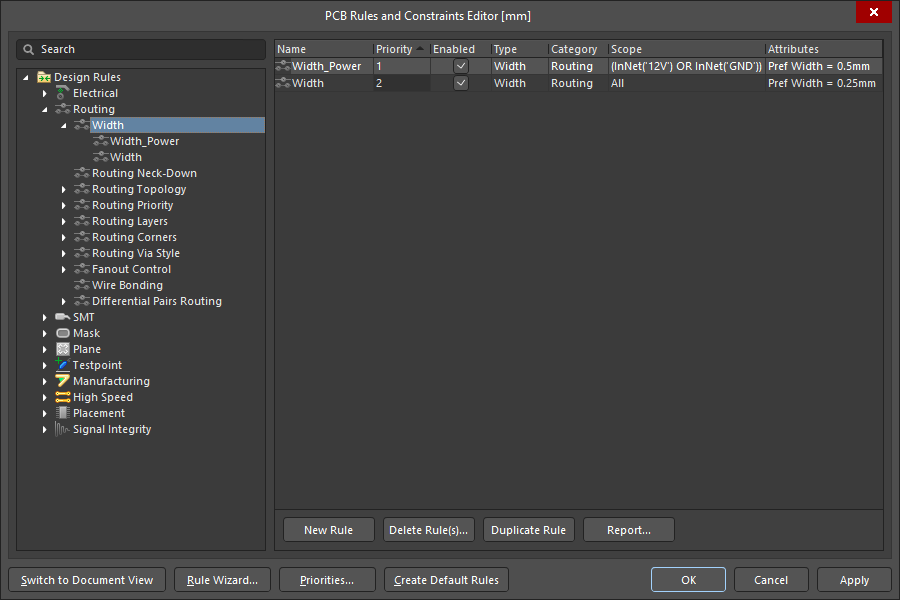

---

# The Worst:

Here are a few aspects of the Flux PCB design tool that definitely needs to be improved.

## 1) The AI

Flux AI over promises, under delivers; Maybe this is applicable to all AI companies.

Other than helping with component selection, it not much good for anything else. Although it does have context of the schematic and PCB, its not ready to be used in production.

As a test,

* I gave a schematic PDF and asked it to recreate that in flux - not done

* Next I placed all the components and asked it to adjust the placements and do the wiring - not done

* So I manually did the schematic and pcb layout, Then tried the auto router feature - typical autorouter

This was a basic ESP32-C3 module based design. The co-pilot burned 300 credits and got nowhere. (300 credits would have cost 12 USD)

This is the contradicting part: For these simple you might as well just do it manually since the copilot is currently dead slow, and for more complex designs it cant help.

For my design sessions, it would cost me additional 25-100 USD worth of credits each week. As a hardware engineer, this would be a good deal if it actually worked since It would be a real time saver just to automate the simple tasks. Flux still has a long way to go.

## 2) No import/export

I consider this a basic feature. Flux can't import projects from other EDA tools, and it also can't export to other formats.

You can't even import a Flux file back into Flux, which is puzzling...

Personally, I don't like using any software that lacks interoperability, as it increases the risk of vendor lock-in.

---

# Final thoughts:

## AI & Hardware:

Vibe coding is nice for making simple apps and websites. If anything goes wrong, it just takes another update to fix it. For personal projects, this costs nearly nothing, maybe some loss of time.

But the AI aspect of hardware is highly problematic in the current stages. As with any hardware projects, it costs time and money, and for each revision it takes a lot of work to design, wait for the boards to arrive, then complete testing.

So less error-free revisions is better to get the product fast into the market.

Would you trust an AI to design the hardware? Definitely not now, I will just wait till it gets better.

## For beginners:

If you're from a programming background, you might find flux interesting. Definitely checkout the copilot features. Flux currently offers a two week trial.

But if you're looking to get into PCB design, I would suggest EasyEDA or KiCAD - both are free and production ready. [Learn More](https://blog.rambros3d.com/jump-start-your-pcb-adventure)

---

This is actually my second time trying out flux, I first tested flux back in mid-2024. Even though its still slow, The copilot has become better. Looks like they are focusing more on the AI features rather than implementing the basic features.

Flux appears to be in its early stages, so I have high hopes for its future. The development pace is promising, especially with a team that is highly receptive to customer queries and doubts.

> Who knows, I might even be recommending it in a couple of years.
